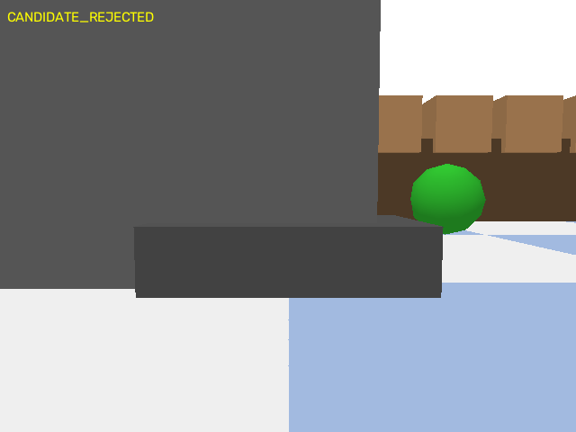
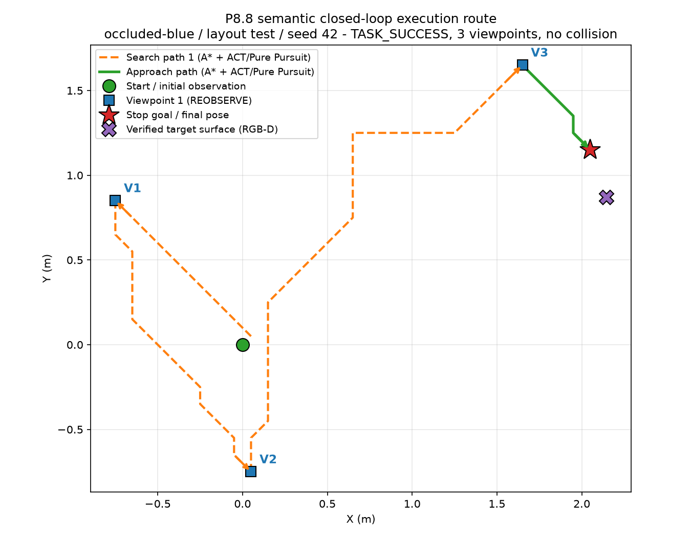
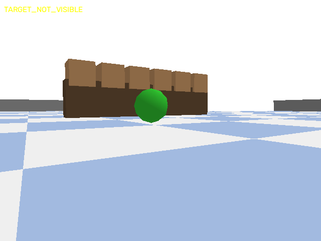
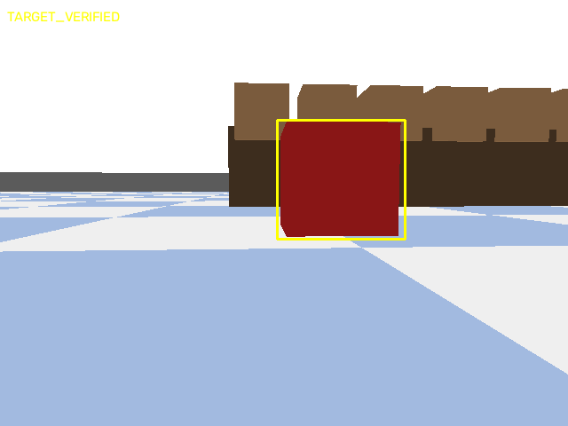
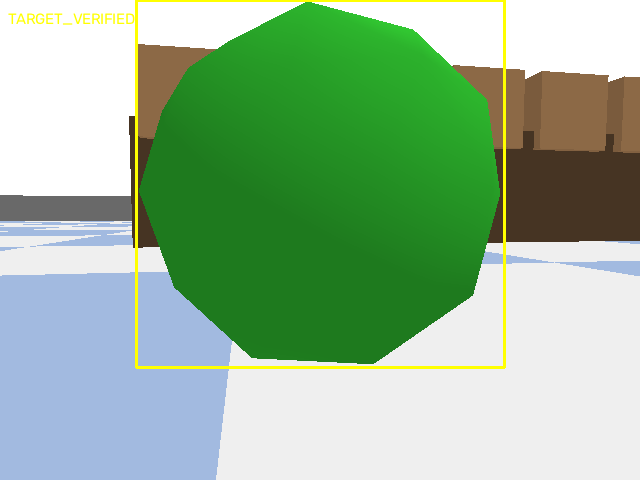
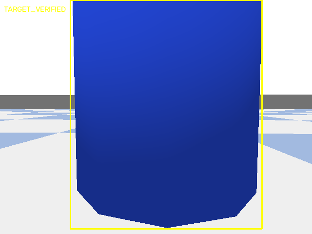
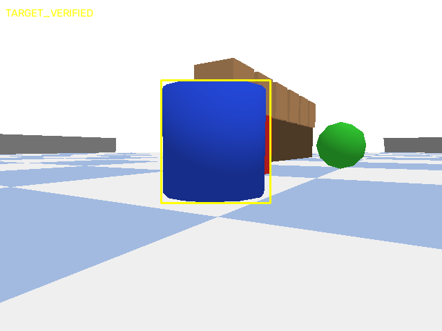
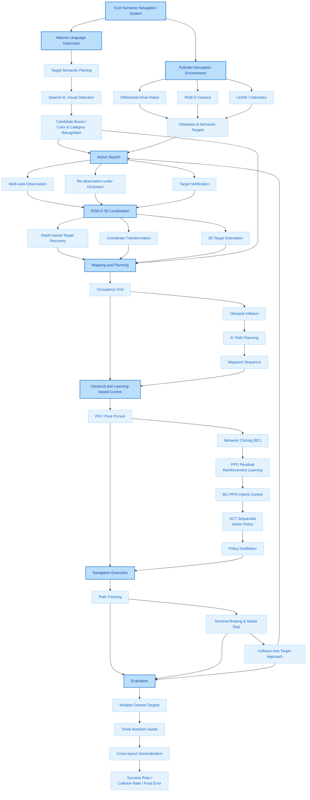

# VisionNav-Edge

**Vision-Language-Guided Mobile Robot Navigation and Learning-Based Control**

面向自然语言指令的移动机器人视觉语义导航与学习型控制系统

A PyBullet-based mobile robot navigation system integrating Qwen3-VL semantic perception, RGB-D localization, A* path planning, BC-PPO reinforcement learning, and ACT-based action prediction.

VisionNav-Edge is a simulation-based mobile robot navigation project built on PyBullet. It integrates vision-language understanding, RGB-D target localization, classical path planning, imitation learning, reinforcement learning, and Transformer-based action prediction into a unified navigation pipeline.

The project enables a differential-drive mobile robot to understand natural-language navigation instructions (e.g. "移动到蓝色圆柱体"), identify the specified object in visual observations, estimate its spatial position, and autonomously navigate to a safe stop pose in front of the target in simulated warehouse scenarios.

Rather than relying on a single navigation algorithm, the project combines classical planning methods with learning-based control policies, establishing an integrated framework for visual semantic navigation and robot motion learning.

**Three technical mainlines**

- **Vision-language perception** — the robot understands what the user is looking for and where it is: Qwen3-VL structured detection, independent verification, RGB-D 3D localization.
- **Robot navigation** — the robot searches, plans and approaches safely: active viewpoint search, occupancy grid + A*, Pure Pursuit recovery, Terminal Docking with geometric/visual acceptance.
- **Robot learning** — from expert control to learned control: PID expert → Behavior Cloning → residual PPO → ACT action-chunk prediction via Teacher-Student Distillation.

## Demo

Successful P8.8 semantic closed-loop run (occluded-blue / layout test / seed 42) — camera view during the final approach with the verified target bounding box:



Execution route of the same run: 3 active-search viewpoints, then approach and terminal docking (TASK_SUCCESS, no collision). Control split of this run: Distilled ACT executed 1,338 steps while Pure Pursuit recovery took over 1,039 stalled-path steps; terminal refinement moved 0.09410 m in 125 steps and finished with a 0.149528 m front gap and 0.003787 m stop-goal error:



Semantic detection and independent verification (yellow box = verified detection):

| Occluded: TARGET_NOT_VISIBLE | Red box: TARGET_VERIFIED |
| --- | --- |
|  |  |

| Green sphere: TARGET_VERIFIED | Blue cylinder: TARGET_VERIFIED |
| --- | --- |
|  |  |



## 1. Core Features

### 1.1 PyBullet Mobile Robot Simulation
- Differential-drive mobile robot simulation with velocity-level control and wheel-speed conversion.
- RGB, Depth, Segmentation, 36-ray LiDAR, IMU and odometry observations.
- Semantic warehouse scenarios with colored targets (red box / green sphere / blue cylinder) and occlusion obstacles.
- Time-aligned logging of observations, poses, velocities, actions and navigation trajectories.

### 1.2 Vision-Language-Based Semantic Perception
- Qwen3-VL (via local Ollama) for natural-language target understanding and visual object localization.
- Structured JSON protocol with bounding-box normalization, range/size checks and category alias handling.
- Independent verifier: detector/verifier box IoU ≥ 0.5, HSV color-pixel ratio ≥ 0.08, RGB-D geometric gates.
- Explicit rejection of invalid JSON, pseudo boxes, whole-image boxes and ambiguous multi-candidate responses.

### 1.3 RGB-D Target Localization and A* Navigation
- Bounding-box + Depth + camera intrinsics back-projection to camera coordinates, then to world coordinates.
- Occupancy-grid mapping with footprint-aware obstacle inflation.
- A* global planning (Dijkstra kept as comparison baseline); safe approach/parking pose selection instead of driving into the target.
- Waypoint execution, terminal docking and final visual/geometric acceptance.

### 1.4 Active Semantic Search and Navigation
State-machine pipeline:

```text
INITIAL_OBSERVATION -> TARGET_NOT_VISIBLE -> SELECT_VIEWPOINT -> SEARCH_NAVIGATION
-> REOBSERVE -> ... -> TARGET_VERIFIED -> APPROACH_PLANNING -> APPROACH_NAVIGATION
-> TERMINAL_DOCKING -> TERMINAL_VISUAL_VERIFICATION -> TASK_SUCCESS / TASK_FAILED
```

When the requested object is occluded, the robot navigates to alternative viewpoints (budget: 6 viewpoints × 6 views), re-observes and continues toward the verified target. Exhausted search is reported as SEARCH_EXHAUSTED; ground truth is never used online.

### 1.5 Learning-Based Robot Control
**Behavior Cloning (BC)** — expert demonstrations from A* + PID expert controller; 40-dim observation (36 LiDAR + 2 relative waypoint + 2 velocity) to (v, ω); episode-level train/val/test splits; normalization statistics from the training split only.

**Residual PPO (BC-PPO)** — Gymnasium navigation env; PPO learns bounded corrections on top of the frozen BC policy (44-dim path-augmented observation); residual scale selected by cross-seed ablation (0.25); V2 → V3 evolution with paired per-task comparisons.

**ACT (Action Chunking with Transformers)** — Transformer policy over an 8-frame observation history predicting 16-step (v, ω) action chunks, executing the first 4 steps before replanning; BC-PPO V3 teacher policy distilled into the ACT student (Teacher-Student Distillation); controller-state reset on every new A* path; bounded Pure Pursuit recovery on path-progress stall; deterministic terminal slow/braking supervision.

### 1.6 Experimental Evaluation and Generalization
- Repeatable fixed task benchmarks with explicit success criteria (collision, timeout, terminal gap 0.08–0.15 m, stable stop).
- BC vs BC-PPO vs ACT comparisons; multi-seed training/evaluation (42 / 123 / 2026); residual-scale ablation.
- Target-color and layout variations (test / relocated layouts).
- JSON/CSV summaries, per-run evidence archives and regression tests.

## 2. System Architecture



The final online controller is the Distilled ACT policy; BC-PPO V3 serves as its offline teacher and as an independent baseline. Pure Pursuit recovery and Terminal Docking are deterministic safety layers, and their control steps are counted separately from ACT steps.

## 3. Experimental Results

| Experiment | Result |
| --- | --- |
| P2 A* vs Dijkstra | 817 vs 22,274 expanded nodes (~96.3% reduction) |
| P5 BC single closed loop | 977 steps, 0.0643 m final error, no collision |
| P6 BC vs BC-PPO V2 (fixed 20 tasks, seed 42) | 70% → 90% success |
| P6 residual-scale ablation (new 40 tasks, 3 seeds) | scale 0.25: 85% mean, 4.33 pp cross-seed std |
| P6 BC-PPO V3 (40 tasks) | 82.5% success, 0.0948 m mean terminal error |
| P7 hybrid navigation, test layout | red / green / blue 3/3 single-run success, no collision |
| P7 relocated layout | seed 42 red / green / blue success with the fixed implementation |
| P8 ACT Teacher-Student Distillation | val / test first-4 L1 = 0.11145 / 0.17621 |
| P8.8 Distilled ACT semantic closed loop | TASK_SUCCESS, stop-goal error 0.003787 m, no collision |
| P8.9 repeatability | 3 seeds × 3 target colors = 9/9 passed |

Honest boundaries: standalone ACT closed-loop evaluation before the recovery/supervision layers was 0/3 (timeouts); the P8.8 success is a hybrid-system success (Distilled ACT + Pure Pursuit recovery + Terminal Docking); five cross-layout experiments (relocated ×3 seeds, train, val) remain a documented design and were not executed in this project round.

## 4. Technology Stack

| Category | Technologies |
| --- | --- |
| Programming Language | Python |
| Simulation | PyBullet, Gymnasium |
| Computer Vision | OpenCV, RGB-D, HSV |
| Vision-Language Model | Qwen3-VL (2B instruct) |
| Local Model Inference | Ollama |
| Deep Learning | PyTorch |
| Reinforcement Learning | PPO, Stable-Baselines3 |
| Imitation Learning | Behavior Cloning |
| Transformer Policy | ACT (Action Chunking with Transformers) |
| Knowledge Distillation | Teacher-Student Policy Distillation (BC-PPO V3 → ACT) |
| Navigation | A*, Occupancy Grid, Obstacle Inflation |
| Motion Control | PID, Pure Pursuit, Terminal Docking |
| Robot Model | Differential-Drive Kinematics |
| Numerical Computing | NumPy |
| Data Storage | NPY / NPZ, JSON, CSV |
| Development Environment | Windows, Anaconda, VS Code |
| Version Control | Git |

Layered view of the stack:

| Layer | Components |
| --- | --- |
| Perception & understanding | Qwen3-VL, Ollama, OpenCV, RGB-D |
| Planning & localization | A*, Occupancy Grid, 3D localization |
| Learning & control | BC, PPO, ACT, PID, Pure Pursuit |
| Simulation & experiments | PyBullet, Gymnasium, PyTorch, NumPy, JSON/CSV |

## 5. Project Scope

This repository focuses on simulation-based visual semantic navigation and learning-based mobile robot control. It is based on an existing open-source PyBullet simulation framework (see License) with additional perception, localization, navigation, learning and evaluation modules.

The project does **not** claim: an end-to-end VLA model (ACT consumes an 8×40 low-dimensional observation history, not RGB or language tokens), real-world robot deployment, ROS2/Nav2 integration, or embedded NPU inference. The ACT controller is evaluated as part of an integrated navigation system with explicit recovery and terminal safety supervision, not as a fully autonomous standalone policy.

**Project Focus:** Mobile Robotics · Vision-Language Navigation · Robot Learning · Motion Planning · Imitation Learning

## 6. Repository Layout and Stage Map

| Stage | Content | Key code |
| --- | --- | --- |
| P0/P1 | Reproduction, robot & multimodal observations | `scripts/diff_drive_robot.py`, `scripts/05_environment_builder.py`, `visionnav/core/`, `visionnav/simulation/observation_adapter.py`, `experiments/04_sensor_logger_rgbd.py`, `14_capture_unified_observation.py`, `15_record_episode.py` |
| P2 | Occupancy grid, A*/Dijkstra, smoothing, PID tracking | `experiments/occupancy_grid.py`, `astar_planner.py`, `astar_navigation.py`, `dijkstra_compare.py`, `path_smoothing.py`, `scripts/path_planner.py` |
| P3 | Semantic scene, Qwen3-VL protocol, RGB-D localization | `visionnav/simulation/semantic_scene.py`, `experiments/18_build_semantic_index.py`, `19_build_p2_dataset.py`, `20_localize_gt_baseline.py`, `23_qwen_target_bbox.py`, `24_localize_qwen_bbox.py` |
| P4 | VLM + A* + PID semantic navigation baseline | `experiments/25_visual_goal_plan.py`, `26_follow_visual_path.py` |
| P5 | Expert demonstrations & Behavior Cloning | `visionnav/learning/collect_expert.py`, `dataset.py`, `bc_model.py`, `train_bc.py`, `bc_policy.py`, `run_bc_navigation.py`, `experiments/27_evaluate_bc.py` |
| P6 | Residual PPO V2/V3, seeds & ablations | `visionnav/learning/bc_residual_navigation_env_v2.py`, `train_bc_residual_ppo_v2*.py`, `residual_scale_wrapper.py`, `train_bc_residual_ppo_v3.py`, `bc_ppo_v3_controller.py`, `experiments/28_evaluate_pid.py`…`40_evaluate_bc_residual_ppo_v3.py` |
| P7 | VLM active search + BC-PPO V3 + Pure Pursuit + docking | `experiments/27_follow_visual_path_bc_ppo.py` |
| P8 | ACT dataset/model, Teacher Distillation, semantic loop | `visionnav/learning/act_dataset.py`, `act_model.py`, `act_controller.py`, `act_semantic_controller.py`, `experiments/p8_train_act*.py`, `p8_collect_ppo_teacher.py`, `p8_train_act_distill.py`, `p8_evaluate_act*.py`, `28_follow_visual_path_act.py` |

`tests/` contains interface and regression tests for the stages above (`python -m pytest tests`).

## 7. Installation

Python 3.11 with Conda recommended:

```powershell
conda create -n visionnav python=3.11
conda activate visionnav
pip install -r requirements.txt
$env:MKL_THREADING_LAYER = "SEQUENTIAL"
```

Visual demos require a local Ollama server with the VLM weights (not included in this repository):

```powershell
ollama pull qwen3-vl:2b-instruct
ollama serve
```

The code talks to `http://127.0.0.1:11434/api/chat`. GUI demos need a desktop/OpenGL display; controller preflight checks need neither GUI nor Ollama. See [INSTALL.md](INSTALL.md) and [SETUP.md](SETUP.md) for platform troubleshooting.

## 8. Running

From the repository root:

```powershell
# P8 final semantic closed loop (Distilled ACT + active search + recovery + terminal docking)
python experiments/28_follow_visual_path_act.py --mode active-search --scenario occluded-blue --layout test --seed 42 --instruction "寻找蓝色圆柱体并靠近它"

# P7 BC-PPO V3 semantic navigation baseline
python experiments/27_follow_visual_path_bc_ppo.py --mode active-search --scenario occluded-red --layout test --seed 42 --instruction "移动到红色方块"

# P4 VLM + A* + PID baseline
python experiments/25_visual_goal_plan.py --instruction "移动到蓝色圆柱体"
python experiments/26_follow_visual_path.py
```

Training and evaluation entry points:

| Task | Entry |
| --- | --- |
| P5 expert collection / BC training | `python -m visionnav.learning.collect_expert`; `visionnav/learning/train_bc.py` |
| P6 residual PPO training | `python -m visionnav.learning.train_bc_residual_ppo_v2`; `python -m visionnav.learning.train_bc_residual_ppo_v3 --seed 42 --timesteps 100000 --residual-scale 0.25` |
| P6 comparisons & ablations | `experiments/28_evaluate_pid.py`, `29_compare_bc_pid.py`, `31_evaluate_bc_residual_ppo_v2.py`, `32_validate_bc_residual_ppo_v2_seed.py`, `33_evaluate_bc_residual_ppo_v2_400k.py`, `34_evaluate_ppo_residual_scale_ablation.py`, `36_generate_ppo_v3_validation_tasks.py`, `37_evaluate_ppo_v3_validation.py`, `40_evaluate_bc_residual_ppo_v3.py` |
| P8 ACT data / training / Distillation | `python -m visionnav.learning.act_dataset --help`; `experiments/p8_train_act.py`, `p8_train_act_v2.py`, `p8_collect_ppo_teacher.py`, `p8_train_act_distill.py` |
| P8 ACT closed-loop evaluation | `experiments/p8_evaluate_act.py`, `p8_evaluate_act_terminal.py` |

## 9. Model Weights and Data

This repository ships code, documentation and result images only — no model checkpoints or training/run logs. Training entry points above reproduce the artifacts: BC → `models/behavior_cloning/bc_best.pth`, PPO V3 → `models/bc_residual_ppo_v3_seed_*/` (the zip must stay next to its `vecnormalize.pkl`), ACT Distillation → `models/act_distilled/act_best.pth`.

## License and Upstream

The original simulation framework comes from [Abhishek Nair / pybullet_sim](https://github.com/padawanabhi/pybullet_sim); its MIT license and attribution are preserved in [LICENSE](LICENSE). Perception, localization, navigation, learning and evaluation modules beyond the upstream framework are developed in this project.
